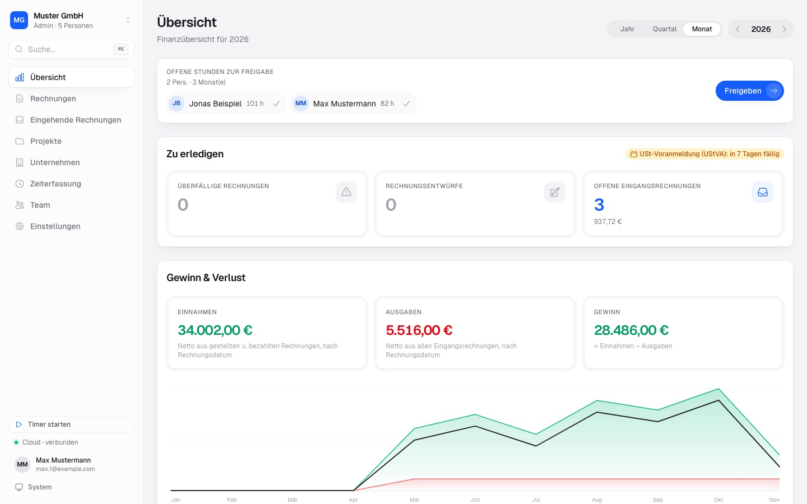
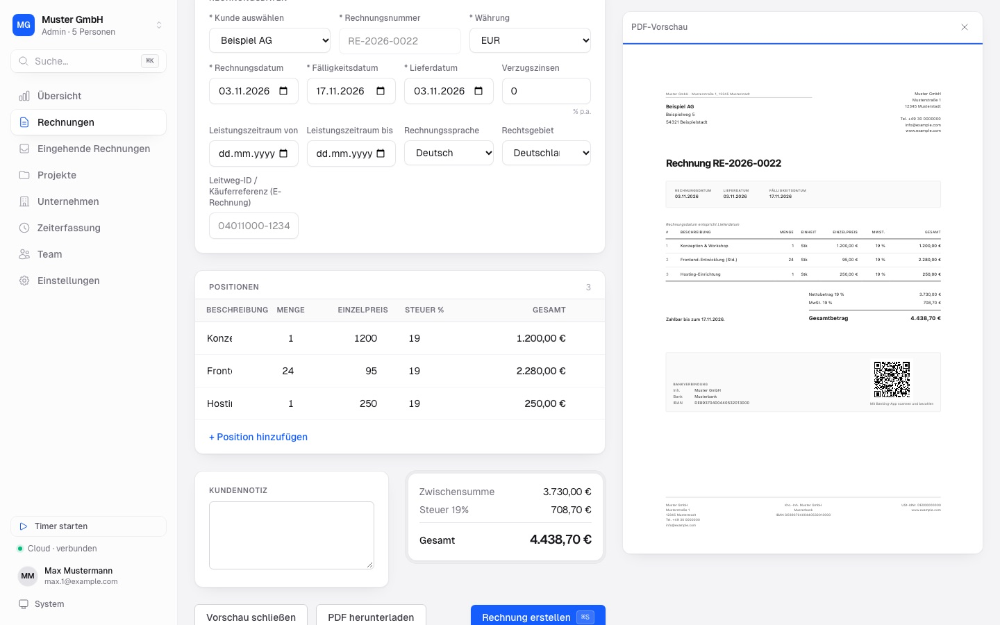
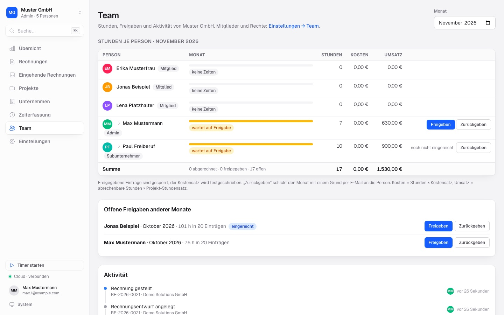
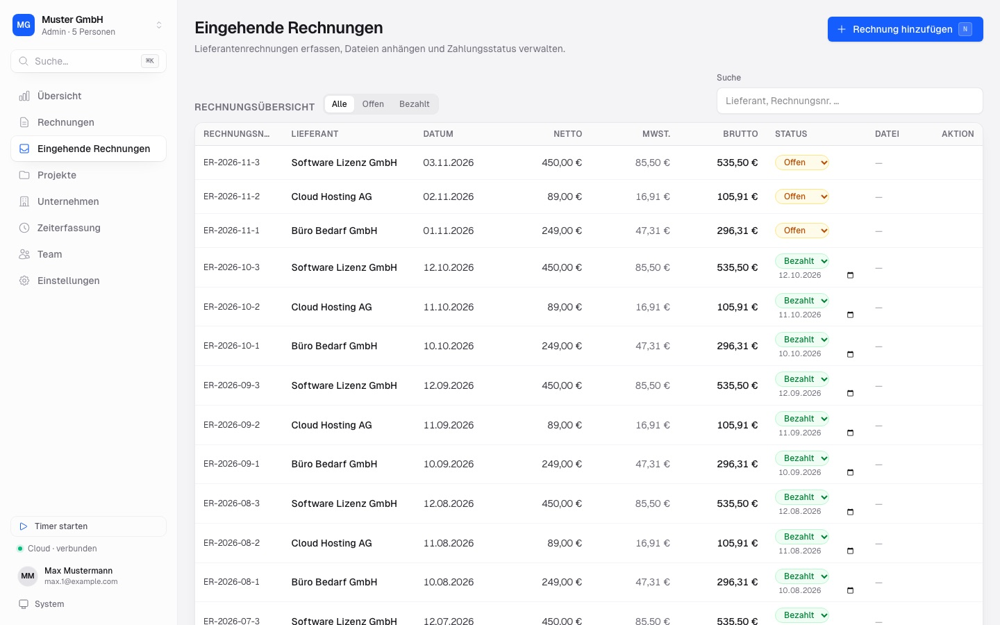
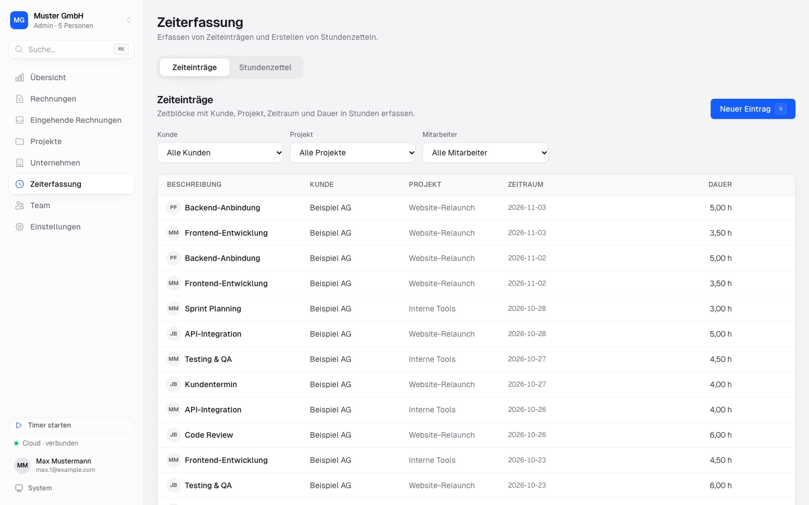
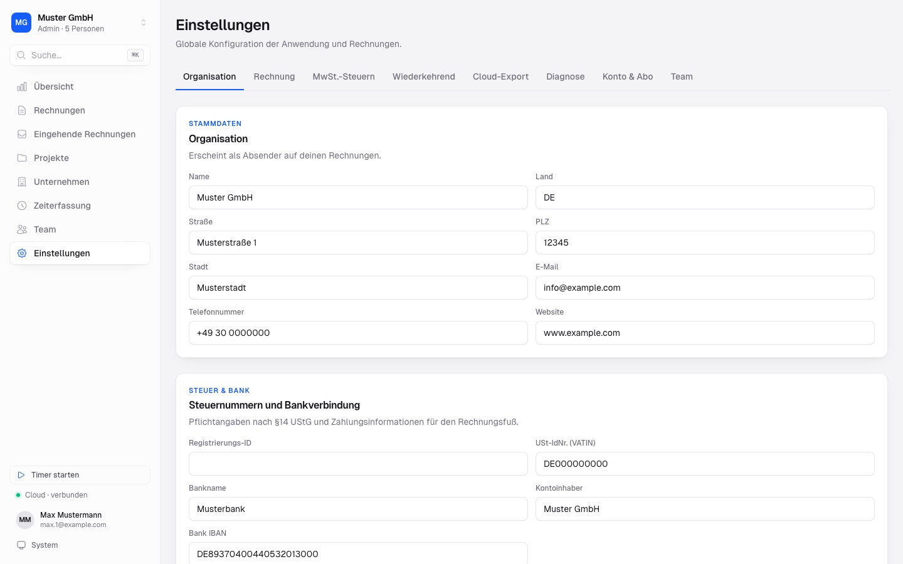

<p align="center">
  
</p>

<p align="center">
  <a href="https://github.com/logscale-it/bookie/releases/latest"></a>
  <a href="https://github.com/logscale-it/bookie/releases"></a>
  <a href="LICENSE.txt"></a>
  <a href="https://tauri.app"></a>
</p>

# Bookie

**Kostenloses Rechnungsprogramm und Buchhaltung für Freiberufler, Kleinunternehmer und kleine Unternehmen.**
Open Source, offline, ohne Abo, ohne Cloud-Zwang. ca. 6 MB.

[⬇ Download für Windows / macOS / Linux](https://github.com/logscale-it/bookie/releases/latest) · [🌐 Website](https://logscale-it.github.io/bookie/de/) · [🇬🇧 English](README.md)

<p align="center"></p>

Eine kostenlose Offline-Alternative zu Abo-Rechnungsprogrammen wie lexoffice oder sevDesk.

### Warum Bookie?

- 🧾 Rechnungen schreiben mit länderspezifischen Pflichtangaben (Profile für DE, AT, CH, FR, NL, US), inklusive Kleinunternehmer-Hinweis
- 🎨 Personalisierte Rechnungs-PDFs: eigenes Logo hochladen, PDF-Vorschau vor dem Versand
- 🔒 100 % lokal: Ihre Buchhaltung bleibt auf Ihrem Rechner (SQLite)
- 📊 Übersicht mit Umsatz sowie Gewinn und Verlust
- ⏱ Zeiterfassung eingebaut
- 💾 Backups, optional mit S3-Synchronisierung
- ☁️ Optionaler Cloud-Modus für Teams: gemeinsame Daten, Rollen, monatliche Zeitfreigabe
- 🪶 Winziger Installer (ca. 6 MB), gebaut mit Tauri + Svelte

<p align="center"></p>

## Download & Installation

Installer gibt es auf der [Website](https://logscale-it.github.io/bookie/de/) (erkennt Ihr System automatisch) oder direkt unter [Releases](https://github.com/logscale-it/bookie/releases/latest):

- **Windows:** `.msi` oder `.exe`
- **macOS:** `.dmg` (nur Apple Silicon)
- **Linux:** `.AppImage`, `.deb` oder `.rpm`

Bookie aktualisiert sich selbst über GitHub Releases.

### Warnung „Unbekannter Herausgeber“ / „kann nicht geöffnet werden“

Bookie ist noch nicht code-signiert, daher warnt Ihr Betriebssystem eventuell. Der Quellcode ist offen und kann geprüft oder selbst gebaut werden.

- **Windows (SmartScreen):** **Weitere Informationen** → **Trotzdem ausführen**.
- **macOS (Gatekeeper):** Rechtsklick auf die App → **Öffnen** → **Öffnen**. Oder: Systemeinstellungen → Datenschutz & Sicherheit → nach unten scrollen → **Trotzdem öffnen**.
- **Linux:** `chmod +x Bookie*.AppImage`, dann starten.

## Cloud-Modus (optional)

Bookie bleibt vollständig offline nutzbar. Wer im Team arbeitet, meldet sich unter **Einstellungen → Cloud** an einem bookie-Server an und bearbeitet dieselben Firmendaten gemeinsam:

- 👥 Team mit Rollen (Admin, Mitglied, Subunternehmer), Rechten je Bereich (Ansehen / Bearbeiten) und Einladungen per E-Mail
- ⏱ Monatliche Zeitfreigabe: Mitglieder reichen einen Monat ein, eine Leitung gibt frei oder gibt zurück; freigegebene Einträge sind gesperrt und abrechenbar
- 🟢 Live-Anwesenheit, Aktivitäts-Feed und Hinweis, wenn jemand denselben Datensatz geöffnet hat
- 🧾 Rechnungen, Zahlungen, Storno, Eingangsrechnungen mit Belegen, wiederkehrende Einträge und Auswertungen laufen über den Server
- 🔐 Zwei-Faktor-Anmeldung; das Sitzungs-Token liegt im Schlüsselbund des Betriebssystems
- 📦 Einmalige Übertragung der lokalen Daten (inkl. Belegdateien) in eine leere Cloud-Firma; die lokale Datei bleibt unverändert und ist nach dem Abmelden wieder da
- 💾 Cloud-Export aller Firmendaten und Belege, auch ohne aktives Abo

Abrechnung pro Platz (5 €/Monat). Ohne Anmeldung verlässt nichts Ihren Rechner.

<p align="center"></p>

## Screenshots

| | |
|---|---|
|  |  |
|  |  |

_Die Screenshots zeigen Beispieldaten (Muster GmbH, example.com)._

## Roadmap

- E-Rechnung (XRechnung / ZUGFeRD): Empfangen und Erstellen, in Arbeit, siehe [docs/e-rechnung-status.md](docs/e-rechnung-status.md)
- Englische Oberfläche und weitere Länder, siehe offene Issues mit Label `help wanted`

## Entwicklung

Voraussetzungen: [Rust](https://rustup.rs) (stable), [Bun](https://bun.sh) und die [Tauri-Systemabhängigkeiten](https://v2.tauri.app/start/prerequisites/) Ihres Betriebssystems. Genaue Pakete stehen in [CONTRIBUTING.md](CONTRIBUTING.md).

```bash
bun install          # Abhängigkeiten installieren
bun run tauri dev    # Entwicklungsmodus
bun run tauri build  # Produktions-Build
```

## Mitmachen

Siehe [CONTRIBUTING.md](CONTRIBUTING.md) und die Issues mit [`good first issue`](https://github.com/logscale-it/bookie/labels/good%20first%20issue). Hilfe bei weiteren Sprachen und Ländern sowie bei Performance und Größe ist willkommen.

## Lizenz

MIT, siehe [LICENSE.txt](LICENSE.txt).
