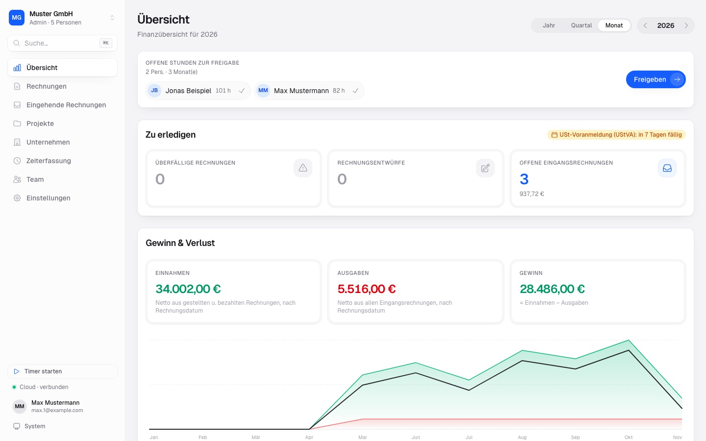
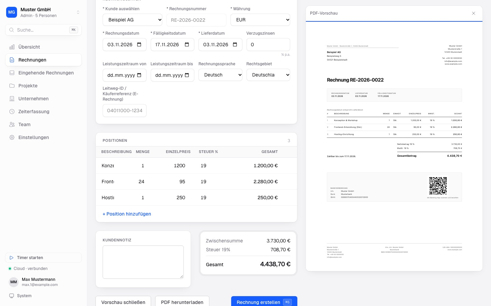
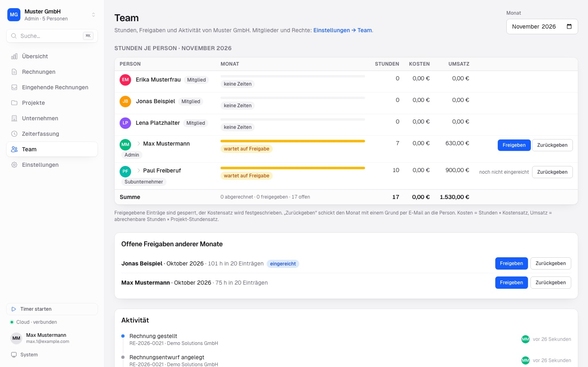
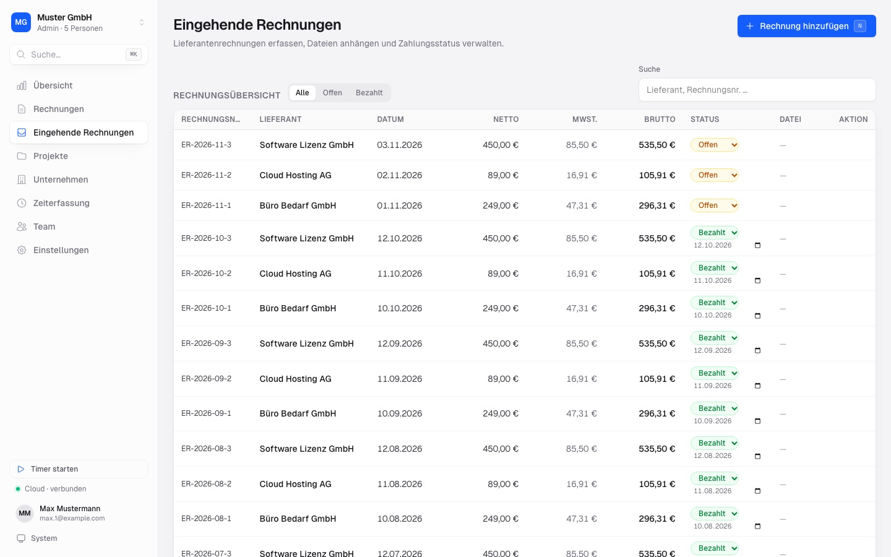
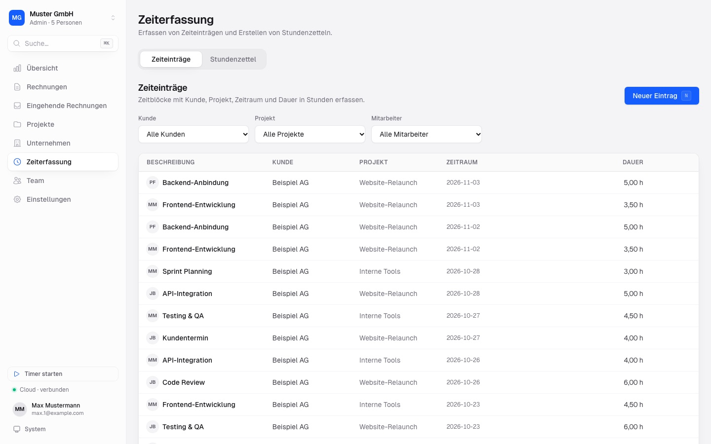
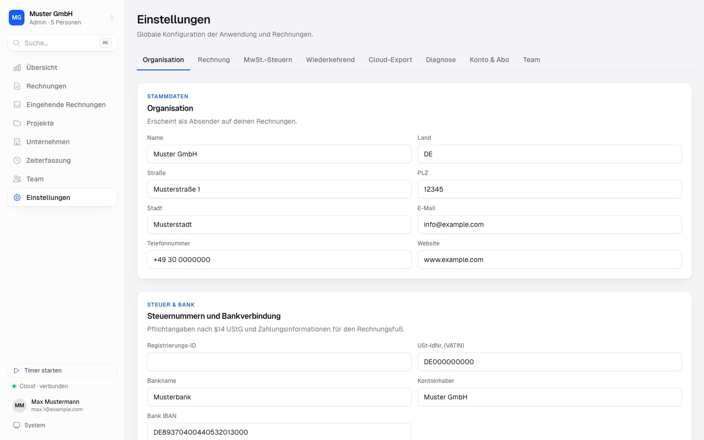

<p align="center">
  
</p>

<p align="center">
  <a href="https://github.com/logscale-it/bookie/releases/latest"></a>
  <a href="https://github.com/logscale-it/bookie/releases"></a>
  <a href="LICENSE.txt"></a>
  <a href="https://tauri.app"></a>
</p>

# Bookie

**Local-first invoicing & bookkeeping for German freelancers and small businesses.**
Free, open source, no subscription, no cloud required. ~6 MB.

[⬇ Download for Windows / macOS / Linux](https://github.com/logscale-it/bookie/releases/latest) · [🌐 Website](https://logscale-it.github.io/bookie/) · [🇩🇪 Deutsch](README.de.md)

<p align="center"></p>

A free, offline alternative to subscription invoicing tools like lexoffice or sevDesk.

### Why Bookie?

- 🧾 Create invoices with country-specific mandatory fields (profiles for DE, AT, CH, FR, NL, US)
- 🎨 Personalized invoice PDFs: upload your own logo, preview the PDF before sending
- 🔒 100% local: your data stays on your machine (SQLite)
- 📊 Dashboard for revenue and profit/loss
- ⏱ Built-in time tracking
- 💾 Backups, with optional S3 sync
- ☁️ Optional cloud mode for teams: shared data, roles, monthly time approval
- 🪶 Tiny: ~6 MB, built with Tauri + Svelte

<p align="center"></p>

## Download & install

Get the installer from the [website](https://logscale-it.github.io/bookie/) (it detects your OS) or straight from the [latest release](https://github.com/logscale-it/bookie/releases/latest):

- **Windows:** `.msi` or `.exe`
- **macOS:** `.dmg` (Apple Silicon)
- **Linux:** `.AppImage`, `.deb` or `.rpm`

Bookie updates itself from GitHub Releases.

### "Unknown publisher" / "can't be opened" warnings

Since v0.1.15 the macOS app is signed with a Developer ID and notarized by Apple, so it opens without the "unidentified developer" warning. The Windows build is not yet code-signed, so SmartScreen may warn you. The app is open source and you can inspect or build it yourself.

- **Windows (SmartScreen):** click **More info** → **Run anyway**.
- **macOS before v0.1.15 (Gatekeeper):** right-click the app → **Open** → **Open**. Or: System Settings → Privacy & Security → scroll down → **Open Anyway**.
- **Linux:** `chmod +x Bookie*.AppImage`, then run it.

## Cloud mode (optional)

Bookie stays fully usable offline. If you work as a team, you can sign in to a bookie server under **Einstellungen → Cloud** and work on the same company data together:

- 👥 Team with roles (admin, member, subcontractor), per-area rights (view / edit) and email invitations
- ⏱ Monthly time approval: members hand in a month, a lead approves or returns it; approved entries are locked and can be invoiced
- 🟢 Live presence, an activity feed, and a hint when a teammate has the same record open
- 🧾 Invoices, payments, storno, incoming invoices with receipts, recurring entries and reports all run against the server
- 🔐 Two-factor authentication; the session token is kept in the OS keyring
- 📦 One-time move of your local data (including receipt files) into an empty cloud company; your local file stays untouched and is back when you sign out
- 💾 Cloud export of all company data and receipts, also without an active subscription

Billed per seat (5 €/month). Without signing in, nothing leaves your machine.

<p align="center"></p>

## Screenshots

| | |
|---|---|
|  |  |
|  |  |

_Screenshots show sample data (Muster GmbH, example.com)._

## Roadmap

- E-Rechnung (XRechnung / ZUGFeRD): receiving and creating, in progress, see [docs/e-rechnung-status.md](docs/e-rechnung-status.md)
- English UI and more jurisdictions, see the open issues labelled `help wanted`

## Development

Prerequisites: [Rust](https://rustup.rs) (stable), [Bun](https://bun.sh), and the [Tauri system dependencies](https://v2.tauri.app/start/prerequisites/) for your OS. Exact packages are listed in [CONTRIBUTING.md](CONTRIBUTING.md).

```bash
bun install          # install dependencies
bun run tauri dev    # run in dev mode
bun run tauri build  # production build
```

## Contributing

See [CONTRIBUTING.md](CONTRIBUTING.md). Look for [`good first issue`](https://github.com/logscale-it/bookie/labels/good%20first%20issue)s. Help with other languages and jurisdictions, and with performance and bundle size, is very welcome.

## License

MIT, see [LICENSE.txt](LICENSE.txt).
